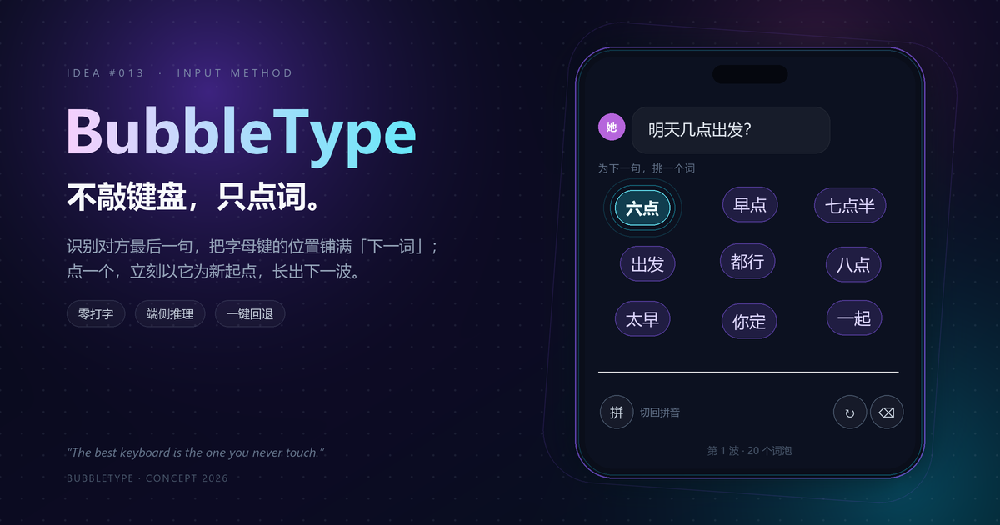
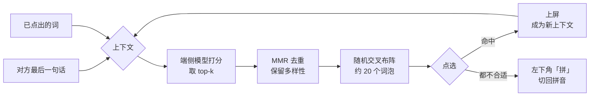

# 🫧 BubbleType · 点词

**不敲键盘，只点词。**

输入法不再等你拼，而是先替你想好下一句——你只负责点。

    

[核心交互](#-核心交互) · [工作原理](#-工作原理) · [技术架构](#-技术架构) · [路线图](#-路线图) · [FAQ](#-faq)

---

> **一句话**：把「打字」变成「挑词」。
> 26 个字母键的位置，全部换成与上一句/上一个词相近的词语泡泡；点一个，它立刻成为新的起点，长出下一波。

它不是自动回复，也不是候选栏的加长版——**每一个词仍然由你亲手点出**，只是把"拼写"换成了"挑选"。

名字来自键盘的样子：一片会呼吸的泡泡，点破一个，长出下一个。

---

## 🎬 它长什么样

对方发来一句「明天几点出发？」，键盘区变成这样：

| 🫧 | 🫧 | 🫧 |
|:--:|:--:|:--:|
| **六点** | 早点 | 七点半 |
| 出发 | 都行 | 八点 |
| 太早 | 你定 | 一起 |

你点了 **六点** —— 它立刻上屏，并成为新的上下文，下一波马上换一批：

| 🫧 | 🫧 | 🫧 |
|:--:|:--:|:--:|
| **出发** | 我到 | 地铁 |
| 你呢 | 太早 | 楼下 |
| 一起 | 七点 | 可以 |

> 词的位置每一波都会**重新打乱**，但语义始终围着上一个词转。
> 实在找不到想要的词——左下角 `拼`，一键切回拼音。

真实的键盘上，泡泡大小不一、错落排列，像一片会呼吸的词场；点中的那一个会亮起，下一波从它身上长出来。

---

## ✨ 核心交互

1. **读** —— 取对方最后一句 + 你已经点出的词，作为上下文。
2. **想** —— 在语义邻域里采样约 20 个「下一词」，按概率与多样性混排。
3. **铺** —— 替换掉原来的字母键区，做成大小不一的泡泡，位置随机交叉。
4. **点** —— 点中即上屏；该词成为新的上下文，**同一瞬间**开始生成下一波。
5. **退** —— 左下角「拼」切回拼音；「↻」换一批；「⌫」删一个词。

> **三条铁律**
> ① 默认路径上不出现键盘字母；
> ② 泡泡按"接下来最可能说什么"排序，而不是按拼音；
> ③ 永远留一扇门——任何时刻一键回到拼音，不劫持用户。

---

## 🧠 工作原理

### 词从哪来

- **上下文** = 对方最后一句（权重最高）+ 最近 1–3 个已选词 + 场景标签（聊天 / 客服 / 邮件）。
- **打分** = `P(w | context) × 多样性惩罚 × 个性化加成`。
- **取词** = top-k ≈ 20，再用 MMR 去掉"意思差不多"的重复项。
- **缓存** = 高频搭配预生成，点选后下一波目标 < 50ms。

### 为什么位置要随机

固定位置会让手指先于眼睛形成条件反射，点得快、也点得错；随机交叉会把注意力拉回「读词」，同时避免某一格被肌肉记忆绑死。

### 什么时候不灵

- 人名、地址、数字、专有名词 → 拼音兜底；
- 对方的话太短、语境不足 → 退化为通用高频词；
- 你就是想写一句"不像自己"的话 → 关掉个性化，用中性词场。

---

## 🛠 技术架构

| 层 | 方案 | 目标 |
|---|---|---|
| 端侧模型 | 1–3B 量化小模型 / 蒸馏草稿模型 | 离线、低延迟、内容不出设备 |
| 推理 | 投机解码 + 词表裁剪 | 单波 < 50ms |
| 上下文 | 对方消息 + 已选词 + 场景标签 | 输入框上下文；Android 可扩展读屏，iOS 受限 |
| 排序 | 概率 × MMR 多样性 × 个性化 | 避免 20 个"好的" |
| 布阵 | 抖动网格 / 泊松盘采样 | 不重叠、位置随机 |
| 回退 | 系统拼音键盘 | 一键切换，保留已输入 |
| 隐私 | 全本地推理 | 聊天内容不上传 |

---

## 📊 它和普通输入法差在哪

| | 传统拼音输入法 | BubbleType |
|---|---|---|
| 起点 | 你拼出读音 | 对方的话 + 上文 |
| 单位 | 字 / 词候选 | 词、短语、半句话 |
| 界面 | 上方一条候选栏 | **整个键盘都是候选** |
| 瓶颈 | 拼写与选字 | 阅读与判断 |
| 擅长 | 精确输入、生僻内容 | 高频对话、即时回复 |
| 退路 | — | 一键回拼音 |

---

## 🎯 适合谁

- 聊天高频、回复套路化的年轻人；
- 单手操作、走路 / 通勤场景；
- 客服、运营等重复话术岗位；
- 长辈与输入困难者——点词比拼音门槛低；
- 外语学习者——按语境给搭配，而不是逐词查。

---

## 🧩 设计取舍与已知问题

- **系统限制**：iOS 键盘扩展读不到聊天界面文本，只能拿输入框内上下文；Android 通过 `InputConnection` 可以拿到更多。所以先做 Android，iOS 侧退化为"输入框 + 剪贴板"。
- **冷启动**：新用户前几天的词场会不准。用通用语料 + 场景模板过渡，三天后再逐步个性化。
- **长尾表达**：泡泡永远覆盖不了所有想说的话，所以拼音入口必须显眼、必须一键可达。
- **误触**：泡泡触控区不小于 44pt；点错可立即撤销，不打断输入。
- **AI 味**：词场来自「你的」历史选择与口癖，不是全网平均语气；提供语气开关（简洁 / 热情 / 正式）。
- **速度悖论**：它优化的不是盲打速度，而是"想出下一句"的时间。

---

## 🗺 路线图

| 版本 | 目标 | 验收标准 |
|---|---|---|
| **v0.1** | 网页原型：假聊天窗 + 词泡键盘 | 连续点 10 句不别扭 |
| **v0.2** | 接入端侧小模型，真实上下文 | 单波 < 100ms，离线可用 |
| **v0.3** | Android 输入法壳，读屏取上下文 | 在微信里连续聊 10 分钟 |
| **v1.0** | 个性化：口癖、常用搭配、语气 | 用户觉得"像我说的" |
| **v2.0** | 语音 / 表情 / 图片一键成句 | 多模态输入闭环 |

---

## ❓ FAQ

**Q：找不到想要的词怎么办？**
左下角「拼」切回拼音；也可以「↻」换一批，或长按泡泡找近义。

**Q：会不会所有人说话都变成一个味？**
词场来自你的上下文与历史选择，个性化权重会逐渐偏向你的口癖；随机交叉也保证每波不同。

**Q：位置每次都变，不会更慢吗？**
第一周会慢，之后靠"读词"而不是"找键"。它省的是"想到下一句"的时间，不是盲打时间。

**Q：隐私怎么办？**
默认全本地推理，聊天内容不出设备；云端增强必须显式开启。

**Q：和"联想输入"有什么区别？**
联想是候选栏的补充，主角仍是拼音；BubbleType 把候选变成主角，拼音退成备胎。

**Q：支持方言和外语吗？**
换词表即可；外语场景下泡泡是"下一词组"，逻辑完全一致。

---

## 🤝 一起玩

这是一个概念阶段的点子，欢迎：

- 交互与动效设计建议；
- 端侧小模型、低延迟推理方案；
- Android IME / iOS Keyboard Extension 经验；
- 直接开 issue 吐槽"这玩意真的会更快吗"。

## 📄 License

MIT —— 随便拿去玩，注明出处即可。

---

**最好的输入法，是让你忘记输入法。**

`BubbleType · 点词` · 2026

