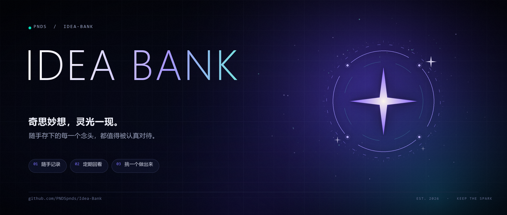
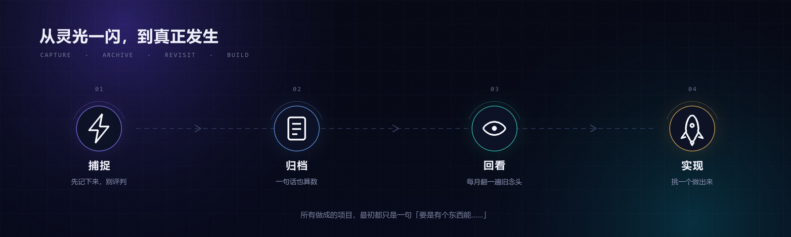

<div align="center">
  
</div>

<div align="center">

[](https://github.com/PNDSpnds/Idea-Bank/stargazers)
[](https://github.com/PNDSpnds/Idea-Bank/commits)
[](https://github.com/PNDSpnds/Idea-Bank/tree/main/2026年)

**把一闪而过的念头，存成未来的资产。**

<a href="#为什么把点子存起来">为什么</a> ·
<a href="#仓库结构">结构</a> ·
<a href="#一个点子长什么样">模板</a> ·
<a href="#收录原则">原则</a> ·
<a href="#怎么逛这个仓库">怎么逛</a> ·
<a href="#关于作者">关于</a>

</div>

---

> 灵感是易碎品。
> 大脑擅长产生它，却不擅长保存它。

这里没有完整的产品文档，也没有经过验证的商业计划。
只有一些在洗澡时、地铁上、凌晨两点关灯之后突然冒出来的念头，
被随手接住，按年份收好。

**Idea-Bank** 是一个人的灵感保险箱：不追求正确，只负责在念头消失之前，把它留下来。
目前开放的是 [2026 年](./2026年) 的存档。

## 为什么把点子存起来

我们每天会冒出几十个念头，绝大多数在几分钟内蒸发。
写下来，不是为了立刻去做，而是为了在未来的某一天——当能力、条件、伙伴刚好出现时——它还在。

| 不遗忘 | 能连接 | 可执行 |
| :---: | :---: | :---: |
| 大脑负责想，仓库负责记 | 旧念头会在某天和新念头碰头 | 写下来的想法，才有下一步 |

<div align="center">
  
</div>

<p align="center"><sub><i>捕捉 → 归档 → 回看 → 实现，一个点子的四次心跳。</i></sub></p>

## 仓库结构

```
Idea-Bank/
├── 2026年/      # 2026 年的灵感存档
├── assets/      # README 配图
└── README.md
```

- **按年份归档**：一年一个文件夹，跨年不搬家。
- **形式不限**：一段话、一张草图、一个链接、半页 PPT 都可以，能被看懂就行。
- **保留原样**：状态会变，但当时的记录尽量不改——包括幼稚的部分。

## 一个点子长什么样

不需要长篇大论。一张卡片，四五个问题，就够把一闪念固定下来。

> [!TIP]
> 新建文件时，直接复制下面的模板。写不满也没关系，空白比遗忘好。

```markdown
# 标题｜一句话说清它是什么

> 灵感来源：洗澡时 / 地铁上 / 被某个产品气到

- 日期：2026-03-14
- 标签：`#产品` `#AI` `#交互`
- 状态：🌱 种子

## 它解决什么问题

## 为什么现在可能成立

## 第一步可以怎么做

## 最大的风险 / 反对意见

## 相关点子
```

### 状态的四种样子

| 状态 | 含义 |
| :--- | :--- |
| 🌱 **种子** | 刚记下，只有一个模糊的轮廓 |
| 🌿 **发芽** | 有了场景、形态，或第一版方案 |
| 🌳 **长成** | 正在做，或已经做出来了 |
| 💤 **搁置** | 暂时不成立，但留着以后翻 |

## 收录原则

**一、先收下，再判断。**
记录的时候不做可行性分析。评判是回看时的事，不是捕捉时的事。

**二、一句话也算数。**
不完整、不成熟、不体面，都不是不记录的理由。

**三、不删除，只更新。**
被推翻的点子也有价值——它标记了一条走不通的路。

**四、每月回看一次。**
给旧点子补上状态，或者把两个看似无关的念头接在一起。

**五、少即是多。**
不追求数量，只留下真正让自己心里一动的东西。

## 灵感从哪来

- 洗澡、散步、失眠的凌晨两点
- 被某个产品气到的瞬间
- 一句「要是……就好了」
- 新技术、新材料、新的政策文件
- 别人的抱怨里
- 梦里（醒来先记，别分析）

## 怎么逛这个仓库

- **按年份**：从 [2026 年](./2026年) 开始翻。
- **按状态**：搜索 `🌱`、`🌿`、`🌳`，看看哪些还在发芽。
- **按标签**：搜索 `#产品`、`#AI`，找到同一主题下的所有念头。
- **随缘**：随便点开一个文件，读三行。也许你会想到它的下一步。

在 GitHub 上也可以直接搜：

```
repo:PNDSpnds/Idea-Bank 关键词
```

## 关于作者

<table>
  <tr>
    <td width="92" valign="middle">
      
    </td>
    <td valign="middle">
      <b>PNDSpnds</b><br>
      把奇怪的想法存进银行，等它们自己长出利息。<br>
      <a href="https://github.com/PNDSpnds">github.com/PNDSpnds</a>
    </td>
  </tr>
</table>

## 版权

本仓库的文字与图片均为原创记录，欢迎阅读、讨论与借鉴。
转载请注明出处；未经许可，请勿直接用于商业用途。

<div align="center">
<br>
<sub>灵感不必宏大，记下来就好。</sub>
<br>
<sub>© 2026 PNDSpnds · Keep the spark.</sub>
</div>
